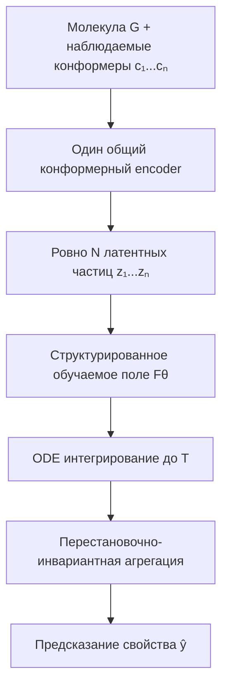

# SwarmChem / НИРМА — план исследования и постановка задачи

## 1. Краткое резюме (abstract)

Исследование посвящено **представлению неполных конформационных ансамблей** для прогнозирования молекулярных свойств. В отличие от одного 2D-графа или одной пространственной структуры молекула может иметь несколько доступных конформеров; использование ансамбля способно дать дополнительные сведения для предсказания свойств [2, с. 1–3]. Предлагается преобразовать каждый **наблюдаемый конформер в ровно одну латентную частицу**, обучать общее структурированное поле их взаимодействий и агрегировать конечные состояния в предсказание свойства. **Цель исследования — проверить, когда именно такие взаимодействия полезнее обычной агрегации**, а не заранее доказать превосходство метода (М1, PDF с. 1–2; М2, §10–11).

Ключевые слова: *conformer ensemble* (конформационный ансамбль), *representation learning* (обучение представлений), *Neural ODE* (нейронное ОДУ), *Cucker–Smale alignment* (согласование скоростей), *permutation invariance* (инвариантность к перестановке), *inductive bias* (структурное ограничение модели), *incomplete ensemble* (неполный ансамбль) [2, с. 1–3; 3, PDF с. 2–3; 4, PDF с. 1–2; 5, PDF с. 4–7].

---

## 2. Постановка научной проблемы

### Что известно

- **Conformer / конформер** — одна из различимых пространственных форм молекулы, соответствующая минимуму потенциальной энергии в принятом конформационном описании. Взаимопревращение конформаций возможно, например, через вращения вокруг одинарных связей [1, печ. с. 23 / PDF с. 31].
- **Conformational ensemble / конформационный ансамбль** — рассматриваемая совокупность доступных конформеров *одной молекулы*. Геометрия и относительная энергия каждого состояния могут влиять на ансамблевые характеристики [2, с. 1–3].
- **Проблема неполноты:** генерация конформеров не обязана обнаруживать все значимые состояния; число найденных конформеров различается между молекулами, а энергии и статистические веса могут быть неточными [2, с. 3–4].
- **Проблема для ML:** вход — набор переменного размера, порядок конформеров не должен влиять на итоговую метку свойства [3, PDF с. 2–3].

### Формулировка задачи

Дан химический граф молекулы $G_m$ и доступный набор её конформеров:

$$
\mathcal C_m=\{c_{m1},\ldots,c_{mN_m}\},\qquad
c_{mi}=(R_{mi},E_{mi},\ldots).
$$

Здесь $R_{mi}\in\mathbb R^{A_m\times3}$ — координаты $A_m$ атомов конформера; $E_{mi}$ — доступная оценка энергии; $N_m$ — число **наблюдаемых** конформеров. Требуется построить функцию $\widehat y_m=f_\theta(G_m,\mathcal C_m)$ для выбранного свойства $y_m$ при неизвестных или недостающих конформациях (М1, PDF с. 1, 3; М2, §10).

**Ключевое ограничение:** отсутствие конформера не означает, что его информацию можно однозначно восстановить. Исследуем точность и устойчивость использования *доступных* данных, а не гарантированную реконструкцию полного ансамбля (М2, §11).

### Почему задача не решена автоматически статистической механикой

Ансамблевое среднее $\langle A\rangle\approx\sum_i p_iA_i$ требует достаточно представительной выборки и обоснованных весов $p_i$. В GEOM явно отмечено, что модельные веса по энергиям приближают вероятности, в которых строгий термодинамический объект связан со свободной энергией [2, с. 3–4, формула (1)]. **Статистическая механика не «не работает»; проблема в неполной или неточной информации на входе.**

---

## 3. Паспорт НИРМА: объект, предмет, цель, задачи

| Категория | Формулировка для лабораторного журнала |
|---|---|
| **Объект** | Конформационные ансамбли органических молекул с геометрическими и доступными энергетическими характеристиками |
| **Предмет** | Структура, обучение, численное интегрирование и устойчивость полей взаимодействия латентных представлений конформеров |
| **Цель** | Разработать и исследовать метод формирования представлений неполных ансамблей на основе обучаемой структурированной роевой динамики для прогноза молекулярных свойств |
| **Вход** | Химический граф $G_m$ и $N_m$ наблюдаемых конформеров $c_{mi}$ |
| **Выход** | Общий embedding $\rho_m$ и предсказанная метка $\widehat y_m$ |
| **Ключевое сравнение** | Mean pooling, Deep Sets, энергетическое усреднение и, затем, attention и свободная Neural ODE |

Формулировка адаптирована из М1 (PDF с. 1–3) и М2 (§10–11). Семейства Deep Sets и Neural ODE описаны в [3, PDF с. 2–3; 4, PDF с. 1–2].

### Основные задачи

1. Формализовать вход, переменное $N_m$, правила симметрии и строгое соответствие 1:1.
2. Проверить операторы согласования и парных сил отдельно от нейросети (**E01, E02**).
3. Проверить корректность численного интегратора, градиента сил, диссипации, движения центра масс и относительной ограниченности.
4. Выбрать целевое молекулярное свойство $y$ и источник независимых меток. **[НУЖНО УТОЧНИТЬ: Sterimol B5 / L / buried B5 или другой target; какие метки уже доступны?]**
5. Реализовать кодирование конформеров, общий обучаемый оператор и инвариантный readout.
6. Сопоставить модели на одинаковых данных и разбиениях; проверить пропуски конформеров.
7. Отделить подтверждённые результаты от гипотез и определить границы применимости метода.

---

## 4. Главное архитектурное ограничение — 1:1

$$
\boxed{N_{\mathrm{latent\ particles}}=N_{\mathrm{observed\ conformers}}}\qquad
c_{mi}\longleftrightarrow z_{mi}(0).
$$

- **Один наблюдаемый конформер → одна и только одна латентная частица.**
- Не создаём дополнительные частицы, не разбиваем один конформер на несколько.
- Между молекулами $N_m$ может меняться.
- Одинаковый кодировщик и общий закон взаимодействий применяются ко всем $i$.
- При перестановке конформеров частицы переставляются соответственно, а молекулярный ответ не меняется [3, PDF с. 2–3; М1, PDF с. 3–4].

**Важно:** в E01–E02 $N=4,8,16$ — количество **искусственных** частиц. Это ещё не конформеры. В существующем прототипе `trainable_conformer_swarm.py` данные конформеров уже представлены строками массива `[N,5]`, а не атомными позициями латентной частицы. Подробности — в файле `03_Код_и_изменения.md`.

### Схема работы модели

Динамика искусственная, **не молекулярная траектория**; её латентная энергия не равна автоматически молекулярной потенциальной или свободной энергии [4, PDF с. 1–2; 9, PDF с. 2–3; М1, PDF с. 3–4].

---

## 5. Научная гипотеза и предполагаемая новизна

### Главная гипотеза

**Операторно-ограниченное обучаемое поле взаимодействий между представлениями доступных конформеров может повысить качество или устойчивость прогнозирования молекулярного свойства по неполному ансамблю относительно моделей без таких взаимодействий.** Эффект зависит от структуры взаимодействий, полноты входа и целевой задачи; преимущество **не гарантировано** (М1, PDF с. 1–2).

### Частные гипотезы из научной постановки

| ID | Проверяемое предположение | Статус |
|---|---|---|
| H1 | Геометрические инварианты помогают переносимости представления | Гипотеза, требует эксперимента |
| H2 | Обучаемые коэффициенты улучшают по сравнению с фиксированным APF | Гипотеза |
| H3 | Мягкий обучаемый граф полезнее фиксированной связности | Отложенная гипотеза |
| H4 | Энергетически ограниченный оператор помогает численной устойчивости | Частично проверена математическая основа E02; ML-эффект не проверен |
| H5 | Ограничения помогают при пропусках, но слишком сильный bias вреден | Гипотеза |
| H6 | Гибридный механизм полезен при недостаточной выразительности чистого роя | Отложенная гипотеза |

Источник формулировок: М1, PDF с. 2, §1.1. Не выдавать таблицу за результаты.

### Как корректно описать научную новизну

**Рабочая формулировка:** предполагаемая новизна заключается в *совместном* исследовании (1) обучаемого поля с ограниченным набором роевых операторов, (2) химически обусловленной инициализации частиц при строгом 1:1, (3) перестановочно-инвариантного ансамблевого readout, (4) влияния состава и неполноты конформерного набора на точность, устойчивость и стоимость вычислений (М1, PDF с. 2–5).

**Не является новизной само по себе:** уравнение Cucker–Smale, искусственный потенциал, Deep Sets, Neural ODE или гамильтонов формализм — эти идеи уже опубликованы [3, PDF с. 2–3; 4, PDF с. 1–2; 5, PDF с. 4–7; 9, PDF с. 2–3].

**[НУЖНО УТОЧНИТЬ: обзор близких работ по ensemble-aware Neural ODE и взаимодействию конформеров за 2025–2026 гг. ещё не завершён; приоритет научной новизны не установлен.]**

---

## 6. Рабочий план: что выполнено и что дальше

| Этап | Содержание | Проверка | Статус на 17.11.2026 |
|---|---|---|---|
| **E01** | Симметричное согласование $\dot V=-L_AV$ | Средняя скорость; $\lambda_2$; `expm` | **Выполнено, проверено:** 36 сценариев, 12 тестов |
| **E02** | $\dot q=v$, потенциальная сила и согласование | Энергия, диссипация, перенос, градиенты | **Выполнено, проверено:** 45 сценариев, 27 тестов |
| **E02+** | Разные графы $A,B$, гармоническая модель и независимый эталон | `expm`, спектральная оценка | **Дополнительная проверка выполнена:** 18 сценариев, 8 новых тестов |
| **E02.3** | Дополнительные длительные горизонты отталкивания | $R_\mathrm{RMS}$, $R_\max$, нормы сил | **Планируется**; отдельного полного запуска нет |
| **E03** | Конформер → частица 1:1, обучаемая модель + Deep Sets | Permutation test, loss, MAE, ablation | **Есть предварительный прототип**, не полноценная Neural ODE |
| **E04** | Исключение конформеров | $\Delta\mathrm{MAE}$ при пропусках | **Планируется** |
| **E05** | Реальная целевая молекулярная метка | Честное сравнение с baseline | **Зависит от выбора данных/метки** |

Численные результаты E01–E02 и E02+ получены повторным запуском приложенного к пакету кода. E03-прототип использует RDKit-конформеры, но **синтетическую** регрессионную метку; его результат нельзя выдавать за прогноз экспериментальной химии (М3–М4, исходный `trainable_conformer_swarm.py`).

### Минимальные результаты к предзащите (7 минут + 5 минут вопросов)

- **Слайд 1:** научная проблема; почему один 2D-граф или одна конформация неполны [2, с. 1–3].
- **Слайд 2:** архитектура 1:1 и предполагаемая новизна — подчёркнуто как гипотеза.
- **Слайд 3:** E01: консенсус и спектральная скорость [6, печ. с. 46–47].
- **Слайд 4:** E02: закон энергетического баланса и контрпример «энергия убывает — расстояния растут» [5, PDF с. 4–7; 7, PDF с. 3–5].
- **Слайд 5:** E02+: аналитическое решение и проверка относительной ограниченности.
- **Слайд 6:** первый ML-прототип и сравнительный baseline без заявлений о превосходстве.
- **Слайд 7:** ограничения, следующий эксперимент, вопросы к руководителю.

**Приоритет ближайшей работы:** не расширять теорию без остановки; подготовить проверяемый E03 с моделью 1:1, контролем обходного пути через readout и одинаковыми train/test выборками.

---

## 7. Что уточнить до реальных молекулярных экспериментов

1. **[НУЖНО УТОЧНИТЬ: какой конкретно target $y$ и откуда берётся независимая метка?]**
2. **[НУЖНО УТОЧНИТЬ: какой конформационный набор — GEOM, собственные RDKit/MMFF, MARCEL или иной — согласован?]**
3. **[НУЖНО УТОЧНИТЬ: какие дескрипторы/геометрические инварианты являются обязательными для первого кодировщика?]**
4. **[НУЖНО УТОЧНИТЬ: используется энергия $E_i$ или свободная энергия $G_i$, учитываются ли вырождения $g_i$ и при какой температуре?]**
5. **[НУЖНО УТОЧНИТЬ: достаточно ли для предзащиты E01–E02 и синтетического E03, либо нужен реальный химический target?]**
6. **[НУЖНО УТОЧНИТЬ: считается ли текущий `trainable_conformer_swarm.py` исходным прототипом E03 для доработки?]**

---
## Список научных источников

1. **IUPAC.** *Principles of Chemical Nomenclature: A Guide to IUPAC Recommendations* (1998). §3.8.2 «Conformational isomers (or conformers)»; **печатная с. 23, PDF с. 31**. https://iupac.org/wp-content/uploads/2018/05/principles_of_nomenclature98.pdf
2. **Axelrod S., Gómez-Bombarelli R.** GEOM, energy-annotated molecular conformations for property prediction and molecular generation. *Scientific Data* **9**, 185 (2022). **С. 1–4**, особенно с. 1 (ансамбли), с. 3–4, формула (1) (веса и энергии). https://doi.org/10.1038/s41597-022-01288-4
3. **Zaheer M. et al.** Deep Sets. *NeurIPS* (2017). **PDF с. 2–3**, §2.1–2.2 и §3.1, теорема 2. https://papers.neurips.cc/paper_files/paper/2017/file/f22e4747da1aa27e363d86d40ff442fe-Paper.pdf
4. **Chen R. T. Q., Rubanova Y., Bettencourt J., Duvenaud D.** Neural Ordinary Differential Equations. *NeurIPS* (2018). **PDF с. 1–2**, формула (2), §1–2. https://proceedings.neurips.cc/paper_files/paper/2018/file/69386f6bb1dfed68692a24c8686939b9-Paper.pdf
5. **Carrillo J. A., Fornasier M., Toscani G., Vecil F.** Particle, Kinetic, and Hydrodynamic Models of Swarming (2009). **PDF с. 4–7**, §2.2–2.3, модели потенциальных сил и согласования. Исходный PDF — `Particle_Kinetic_and_Hydrodynamic_Models_of_Swarmi.pdf`.
6. **Mesbahi M., Egerstedt M.** *Graph Theoretic Methods in Multiagent Networks*. Princeton University Press, 2010. **Печатные с. 46–47; PDF с. 67–68**, §3.1, теорема 3.4, формулы (3.6)–(3.9). Исходный PDF — `Princeton_Series_in_Applied_Mathematics_Mehran_Mesbahi,_Magnus_Egerstedt.pdf`.
7. **Daun J., Happ D. J., Jacob B., Totzeck C.** Erratum to: Port-Hamiltonian structure of interacting particle systems and its mean-field limit (версия 2026). **PDF с. 3–5**, теорема 1.3, контрпример 1.4, теорема 1.5. Исходный PDF — `Erratum_to_Port_Hamiltonian_structure_of_interacting_particle_systems.pdf`.
8. **Roth et al.** Stable Port-Hamiltonian Neural Networks (версия 2025). **PDF с. 3–5**, формулы (3)–(4), теорема 3.1. Исходный PDF — `Stable Port-Hamiltonian Neural Networks.pdf`.
9. **Greydanus S., Dzamba M., Yosinski J.** Hamiltonian Neural Networks (2019). **PDF с. 2–3**, уравнения Гамильтона и подход к обучению. Исходный PDF — `Hamiltonian Neural Networks.pdf`.

10. **Landauer R.** Irreversibility and Heat Generation in the Computing Process. *IBM Journal of Research and Development* **5**(3), 183–191 (1961). **С. 183–191**. DOI: https://doi.org/10.1147/rd.53.0183. Используется только для уточнения условий принципа Ландауэра в исходном конспекте.

### Внутренние материалы проекта (не рецензированные научные источники)

- **М1.** *TLE-SDC-NDE: научная постановка, математика, программа* (октябрь 2026). **PDF с. 1–5**, §1–7. Проектные гипотезы не являются доказанными результатами.
- **М2.** *Горбунова Анастасия, ТЗ.docx* (2026). Разделы **10–11 и 15**; стабильной нумерации страниц у редактируемого DOCX нет.
- **М3.** `REPORT_E01.md` и исходный код E01 (2026). Разделы «Условия», «Численная корректность», «Ограничения»; Markdown без страниц.
- **М4.** `REPORT_E02.md` и исходный код E02 (2026). Разделы «Модель», «Конфигурация», «Ключевые результаты», «Ограничения»; Markdown без страниц.
- **М5.** *Вставленный текст.txt* — исходный личный конспект по статистической механике. Первичная презентация/видео не приложены; **[НУЖНО УТОЧНИТЬ: библиографические данные исходной лекции]**.
