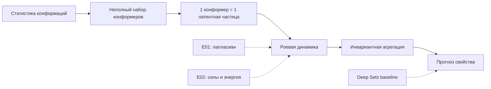

# appliedMathForChem
# 3.1 Статистическая механика и моделирование ансамблей: от молекул к макроскопическим свойствам

## 1. Краткое резюме (abstract)

Презентация посвящена **statistical mechanics (статистической механике)** и переходу от микроскопического описания множества молекул к устойчивым макроскопическим свойствам. Основные темы: **microstate (микросостояние)** и **macrostate (макросостояние)**, энтропия и информация, температура, законы термодинамики, теплоёмкость, микроканонический ансамбль, распределение Больцмана, свободная энергия, химический потенциал, Monte Carlo sampling (семплирование Монте-Карло) и ergodicity (эргодичность).

Ключевая идея: при переходе к макроскопическим параметрам — температуре, давлению и плотности — теряется возможность различать множество микросостояний; макроскопические свойства являются **emergent properties (эмерджентными свойствами)** и отсутствуют на масштабе отдельной молекулы.

---

## 2. Основные понятия и определения

### Microstate (микросостояние) и macrostate (макросостояние)

- У отдельных молекул нет температуры, давления или плотности.
- При переходе к макроскопическим параметрам теряется возможность различать множество микросостояний — **информация теряется**.
- Разные микросостояния могут выглядеть одинаково на макроуровне.
- Число способов реализовать макросостояние связано с количеством перестановок частиц.

Для $N$ частиц, если $n$ частиц находятся в одной части системы, число соответствующих микросостояний:

$$
\Omega(n)=\binom{N}{n}=\frac{N!}{n!(N-n)!}.
$$

При $N\to\infty$ биномиальное распределение переходит в нормальное. Абсолютная дисперсия растёт как $\sqrt{N}$, но относительная ошибка падает:

$$
\frac{\sigma_n}{N}\propto\frac{1}{\sqrt{N}}.
$$

Поэтому при макроскопическом числе частиц свойства системы стабильны.

### Entropy (энтропия)

Макроскопическому равновесию соответствует подавляющее большинство доступных микросостояний.

Энтропия Больцмана:

$$
S=k_B\ln\Omega,
$$

где:

- $S$ — энтропия;
- $k_B$ — постоянная Больцмана;
- $\Omega$ — число статистически доступных способов реализовать макросостояние.

Логарифм используется для свойства аддитивности.

Глобально энтропия растёт, но локально может уменьшаться ценой увеличения энтропии внешней среды.

### Landauer principle (принцип Ландауэра)

При потере 1 бита информации происходит понижение энтропии: два возможных состояния, $0$ или $1$, переходят в одно состояние. Энтропия внешней среды должна увеличиться.

Связь информации и термодинамики выражается через минимальный масштаб энтропии одного бита:

$$
\Delta S = k_B\ln 2.
$$

### Temperature (температура)

Температура определяется через изменение энтропии при изменении внутренней энергии:

$$
\frac{1}{T}=\left(\frac{\partial S}{\partial U}\right)_{V,N}.
$$

С учётом $S=k_B\ln\Omega$:

$$
\frac{1}{k_BT}=\frac{\partial\ln\Omega}{\partial U}.
$$

Правая часть показывает, **как быстро растёт логарифм числа микросостояний при добавлении энергии**.

### Zeroth law of thermodynamics (нулевой закон термодинамики)

Если система $A$ находится в тепловом равновесии с системой $B$, а система $B$ — с системой $C$, то $A$ и $C$ тоже находятся в тепловом равновесии.

При равновесии обмен энергией уже не приводит к повышению общей энтропии; уравновешивается именно температура.

### Laws of thermodynamics (законы термодинамики)

- **First law (первый закон):** энергия не исчезает и не берётся из ниоткуда; тепло, сообщаемое системе, идёт на изменение внутренней энергии и совершение работы.
- **Second law (второй закон):** в изолированной системе энтропия либо остаётся неизменной, либо возрастает в неравновесных процессах, достигая максимума при равновесии.
- **Third law (третий закон):** существует минимальная температура; при ней для идеального совершенного кристалла энтропия стремится к минимальному значению.

### Heat capacity (теплоёмкость)

Теплоёмкость — скорость изменения внутренней энергии при изменении температуры:

$$
C_V=\left(\frac{\partial U}{\partial T}\right)_V.
$$

Из термодинамических соотношений:

$$
C_V=T\left(\frac{\partial S}{\partial T}\right)_V.
$$

Следовательно, теплоёмкость связана с тем, сколько микроскопических состояний становится доступно при поглощении энергии при заданной температуре.

### Gibbs entropy (энтропия Гиббса) и Shannon entropy (энтропия Шеннона)

Если микросостояния имеют неодинаковые вероятности:

$$
S=-k_B\sum_i p_i\ln p_i.
$$

Информационная энтропия Шеннона:

$$
H(X)=-\sum_i p_i\log_2 p_i.
$$

Энтропия отражает, **сколько информации не хватает для точного указания микросостояния**.

### Extensive and intensive variables (экстенсивные и интенсивные величины)

В презентации термодинамика сводится к четырём основным экстенсивным величинам: энергия, энтропия, объём и количество частиц.

Из них получаются интенсивные величины:

$$
T=\left(\frac{\partial U}{\partial S}\right)_{V,N},
$$

$$
P=-\left(\frac{\partial U}{\partial V}\right)_{S,N},
$$

$$
\mu=\left(\frac{\partial U}{\partial N}\right)_{S,V}.
$$

Фундаментальное соотношение:

$$
dU=T\,dS-P\,dV+\mu\,dN.
$$

---

## 3. Ансамбли, распределения и методы

### Microcanonical ensemble (микроканонический ансамбль)

Основные допущения:

- система изолирована;
- полная энергия фиксирована;
- микросостояния равновероятны;
- рассматривается равновесное состояние.

Для системы, которая может обмениваться энергией с намного большей системой — **thermostat / reservoir (термостат / резервуар)** — общая энергия сохраняется:

$$
E_{tot}=E_i+E_R.
$$

Если система имеет энергию $E_i$, резервуару остаётся:

$$
E_R=E_{tot}-E_i.
$$

Вероятность состояния системы пропорциональна числу микросостояний резервуара:

$$
p_i\propto\Omega_R(E_{tot}-E_i).
$$

### Taylor series (ряд Тейлора)

Ряд Тейлора используется как способ заменить сложную гладкую функцию около выбранной точки суммой простых поправок:

$$
f(x)=\sum_{n=0}^{\infty}\frac{f^{(n)}(x_0)}{n!}(x-x_0)^n.
$$

При большом резервуаре энтропию можно разложить в окрестности $E_{tot}$ и оставить первую производную:

$$
S_R(E_{tot}-E_i)\approx S_R(E_{tot})-\frac{E_i}{T}.
$$

### Boltzmann distribution (распределение Больцмана)

Из связи $S=k_B\ln\Omega$ и разложения энтропии получается:

$$
p_i\propto\exp\left(-\frac{E_i}{k_BT}\right).
$$

Распределение порождается конкуренцией двух факторов:

1. количества микросостояний;
2. их энергии.

При низкой температуре выигрывает минимальная энергия, при высокой — число и энтропическая доступность микросостояний.

### Probability of a macrostate (вероятность макросостояния)

Для макросостояния учитываются одновременно энергия и энтропия:

$$
P\propto e^{S/k_B}e^{-E/(k_BT)}.
$$

Эквивалентно:

$$
P\propto\exp\left(-\frac{E-TS}{k_BT}\right).
$$

Возникает **Helmholtz free energy (свободная энергия Гельмгольца)**:

$$
F=E-TS.
$$

Она показывает противоборство энергетической выгодности и статистической доступности.

### Chemical potential (химический потенциал)

Если системе разрешить обмениваться не только теплом, но и веществом, возникает вопрос о выигрыше или проигрыше системы при добавлении новых частиц.

В презентации химический потенциал записан как:

$$
\mu=\left(\frac{\partial G}{\partial N}\right)_{T,P},
$$

где $G$ — Gibbs free energy (свободная энергия Гиббса), $N$ — число частиц.

### Monte Carlo sampling (семплирование Монте-Карло)

Для точного вычисления макроскопического свойства нужно считать ансамблевое среднее относительно всех микросостояний и интеграл по вероятностям их встретить; физически это невозможно.

Поэтому интеграл заменяется конечной суммой. Основная идея Monte Carlo (Монте-Карло) — выбирать состояния для приближённого вычисления так, чтобы чаще генерировать более вероятные физические состояния и сохранять частоты, характерные для распределения Больцмана.

При работе с отношениями вероятностей нормировка на все состояния не требуется.

### Ergodicity (эргодичность)

Формально:

> среднее состояние по времени равно среднему состоянию по ансамблю.

Если дать системе достаточно много времени в рамках одной динамики, она посетит свои состояния с характерными частотами.

Эргодичность может нарушаться, если наблюдаемое свойство достигается намного медленнее, чем длится симуляция.

Эргодичность убирает проблему инициализации: при времени симуляции, стремящемся к бесконечности, начальное состояние перестаёт определять статистическое среднее.

---

## 4. Формулы и обозначения

| Формула | Смысл |
|---|---|
| $S=k_B\ln\Omega$ | Entropy (энтропия) через число микросостояний |
| $\frac{1}{T}=\left(\frac{\partial S}{\partial U}\right)_{V,N}$ | Temperature (температура) через рост энтропии с энергией |
| $C_V=\left(\frac{\partial U}{\partial T}\right)_V$ | Heat capacity (теплоёмкость) |
| $S=-k_B\sum_i p_i\ln p_i$ | Gibbs entropy (энтропия Гиббса) |
| $H(X)=-\sum_i p_i\log_2p_i$ | Shannon entropy (энтропия Шеннона) |
| $dU=T\,dS-P\,dV+\mu\,dN$ | Фундаментальное термодинамическое соотношение |
| $p_i\propto e^{-E_i/(k_BT)}$ | Boltzmann distribution (распределение Больцмана) |
| $F=E-TS$ | Helmholtz free energy (свободная энергия Гельмгольца) |
| $\mu=\left(\frac{\partial G}{\partial N}\right)_{T,P}$ | Chemical potential (химический потенциал) |

Обозначения:

- $U$, $E$ — внутренняя / полная энергия;
- $S$ — энтропия;
- $T$ — температура;
- $P$ — давление;
- $V$ — объём;
- $N$ — число частиц;
- $\mu$ — химический потенциал;
- $k_B$ — постоянная Больцмана;
- $\Omega$ — число микросостояний;
- $p_i$ — вероятность микросостояния $i$;
- $F$ — свободная энергия Гельмгольца;
- $G$ — свободная энергия Гиббса.

---

## 5. Схемы и диаграммы


Переход от изолированной системы к системе в контакте с резервуаром:

```text
Изолированная система
E, V, N фиксированы
        |
        v
Microcanonical ensemble
        |
разрешён обмен энергией
        v
Система + большой reservoir
        |
        v
Taylor expansion энтропии резервуара
        |
        v
p_i ∝ exp[-E_i/(k_B T)]
        |
        v
Boltzmann distribution
```

---

## 6. Выводы и итоги

- Макроскопические свойства возникают как результат статистического описания огромного числа микросостояний.
- При переходе от микро- к макроописанию информация о конкретном микросостоянии теряется.
- Энтропия связывает число доступных состояний, вероятность и информацию.
- Температура определяется через зависимость энтропии от энергии.
- При контакте с большим термостатом вероятность микросостояний определяется распределением Больцмана.
- Свободная энергия объединяет энергетический и энтропийный вклады в вероятность макросостояния.
- Точный перебор всех микросостояний физически невозможен, поэтому используются методы семплирования, в частности Monte Carlo (Монте-Карло).
- Ergodicity (эргодичность) связывает временное среднее одной системы с ансамблевым средним.

Материал для глубокого изучения, указанный в презентации: **«Статистическая механика», Стэнфорд, Леонард Сасскинд**.

---

# 3.2 Конформационные ансамбли и математическая модель SwarmChem

## 1. Краткое резюме (abstract)

Из статистической механики берём **идею ансамбля и взвешенного среднего**, но в исследовании SwarmChem используем не все микросостояния, а **конечный набор найденных конформеров** одной молекулы. Конформер — одна из различимых пространственных форм с характерным минимумом потенциальной энергии [1, печ. с. 23 / PDF с. 31]. Для прогноза свойства предлагается закодировать каждый найденный конформер в одну латентную частицу, запустить обучаемую систему взаимодействий, затем агрегировать полученное состояние. Эту пользу роя предстоит **проверить экспериментально**, она не следует автоматически из статистической механики [2, с. 1–4; 3, PDF с. 2–3; М1, PDF с. 1–4].

**Основной принцип архитектуры:**

$$
\boxed{1\text{ конформер}\;\longleftrightarrow\;1\text{ латентная частица}}.
$$

---

## 2. Термины и понятия

### Conformer (конформер)

- Различимая пространственная форма **одной молекулы**, как правило соответствующая локальному минимуму потенциальной энергии.
- Часто связана с изменением торсионных углов; при переходе через барьер форма может измениться.
- Разные конформеры имеют один и тот же химический граф, если не рассматриваются химические реакции [1, печ. с. 23 / PDF с. 31].

### Conformational ensemble (конформационный ансамбль)

- Совокупность доступных конформаций одной молекулы.
- Каждая форма может иметь свою геометрию, энергию и статистический вес.
- Вычислительно полученный набор **не обязан быть полным** [2, с. 1–4].

### Incomplete ensemble (неполный ансамбль)

В наблюдаемой выборке могут отсутствовать важные конформеры, например низкоэнергетическая форма. Поэтому вероятность после перенормировки по имеющимся состояниям нельзя автоматически отождествлять с истинным полным распределением [2, с. 3–4, формула (1); М1, PDF с. 1, 3].

### Latent particle (латентная частица)

- **Вычислительный объект**, связанный с **одним конкретным наблюдаемым конформером**.
- Имеет координату $q_i(t)$ и скорость $v_i(t)$ в искусственном признаковом пространстве.
- Не является отдельным атомом и не описывает настоящую молекулярную траекторию [4, PDF с. 1–2; М1, PDF с. 3–4].

---

## 3. От статистической механики к ML-прогнозу

### Boltzmann weighting (энергетическое взвешивание)

В приближении дискретных конформационных состояний:

$$
p_i=\frac{g_i e^{-E_i/(k_BT_{\mathrm{phys}})}}{\sum_j g_j e^{-E_j/(k_BT_{\mathrm{phys}})}}.
$$

$E_i$ — оценка энергии, $g_i$ — учтённая кратность, $T_{\mathrm{phys}}$ — **температура**, $k_B$ — постоянная Больцмана. Строгие термодинамические вероятности связаны со свободной энергией; формула по $E_i$ — приближение [2, с. 3–4, формула (1)].

Ансамблевое среднее свойства:

$$
\langle A\rangle\approx\sum_i p_iA_i.
$$

Применяется, **если** усреднение физически соответствует выбранной наблюдаемой величине и известны значения $A_i$ (М1, PDF с. 3).

### Почему возникает научная проблема

**Не требуется заменять статистическую механику.** Требуется получить корректный прогноз по *доступной части* конформационного ансамбля, когда список состояний, их энергии или свойства неполны. Полное восстановление недостающей информации **не гарантируется** (М2, §10–11; [2, с. 1–4]).

---

## 4. Постановка задачи, цель и предполагаемая новизна

### Scientific problem (научная проблема)

Существующие способы представления молекул часто используют двумерный граф или один 3D-конформер, хотя доступные пространственные состояния могут различаться по геометрии и энергии [2, с. 1–3]. Для неполного набора конформеров необходимо понять, **какая архитектура лучше использует имеющуюся информацию** (М1, PDF с. 1–2).

### Research goal (цель)

**Разработать и экспериментально исследовать метод построения ансамблевого представления на основе обучаемых роевых взаимодействий**, проверить точность прогноза и устойчивость к пропущенным конформерам (М2, §10–11).

### Proposed novelty (предполагаемая научная новизна)

Исследуется сочетание трёх элементов:

1. **1:1:** каждый наблюдаемый конформер представлен ровно одной латентной частицей;
2. **Structured Neural ODE:** общее обучаемое поле ограничено определёнными операторами согласования и парных сил;
3. **Invariant readout:** общий молекулярный ответ не зависит от порядка входных конформеров [3, PDF с. 2–3; 4, PDF с. 1–2; 5, PDF с. 4–7; М1, PDF с. 2–5].

Не утверждаем, что отдельные компоненты новы: **Cucker–Smale, Deep Sets, Neural ODE и HNN известны** [3–5, указанные страницы; 9, PDF с. 2–3]. Предполагаемая оригинальность их применения к неполным конформерным наборам ещё требует проверки близких исследований.

---

## 5. Формулы E01–E02 (очень кратко)

### E01. Velocity alignment (согласование скоростей)

$$
\dot V=-L_AV,\qquad L_A=\frac{D_A-A}{N},
$$

$$
\|V(t)-\overline V(t)\|_F\le e^{-\lambda_2(L_A)t}\|V(0)-\overline V(0)\|_F.
$$

$A$ — симметричная матрица связей; $D_A$ — диагональная матрица сумм весов; $N$ — число игрушечных частиц; $\lambda_2$ — второе собственное значение лапласиана. Оценка верна для **фиксированного связного** графа [6, печ. с. 46–47 / PDF с. 67–68, теорема 3.4].

### E02. Pair potential + alignment (силы и согласование)

$$
\dot q_i=v_i,\qquad
\dot v_i=-\nabla_{q_i}P(q)-\kappa(L_AV)_i.
$$

$$
H=\frac12\sum_i\|v_i\|^2+P(q),\qquad
\dot H=-\kappa\,\mathrm{tr}(V^\top L_AV)\le0.
$$

Это **модельное** энергетическое тождество для симметричных неотрицательных связей и согласованной силы $-\nabla P$, а не закон для реальной молекулы [5, PDF с. 4–7; 8, PDF с. 3–5; М4].

**Важно:** $\dot H\le0$ **не гарантирует** ограниченность пространственных координат при произвольном потенциале; см. исправление ошибочных утверждений в [7, PDF с. 3–5, контрпример 1.4].

---

## 6. Рабочие эксперименты и статус

| Эксперимент | Что проверяем | Статус |
|---|---|---|
| **E01** | Графовый лапласиан, консенсус, аналитический эталон | Выполнен: 36 сценариев, 12 тестов |
| **E02** | Парный потенциал, градиенты, диссипация, центр масс | Выполнен: 45 сценариев, 27 тестов |
| **E02+** | Независимые $A,B$, гармонический потенциал, `expm`, радиус | Дополнительный модуль: 18 сценариев, 8 тестов |
| **E02.3** | Длинные горизонты отталкивания | Планируется |
| **E03** | Обучение по конформерам 1:1, сравнение с Deep Sets | Есть предварительный прототип с синтетическим target; полноценная проверка впереди |
| **E04/E05** | Пропуски конформеров и реальная молекулярная метка | Планируется; target не выбран |

Код и границы сделанного подробно разобраны в `03_Код_и_изменения.md`; математические выводы — в `02_Математическая_часть_SwarmChem.md`.

---

## 7. Схема исследования



---

## 8. Редакторские уточнения к исходным записям 3.1

Ниже **исходный текст не исправлен задним числом**. Это список мест, которые стоит уточнить при следующей редакции:

| В исходном тексте | Что точнее | Почему |
|---|---|---|
| «Абсолютная дисперсия растёт как $\sqrt N$» | При биномиальном распределении стандартное отклонение $\sigma_n\sim\sqrt N$, **дисперсия** $\mathrm{Var}(n)\sim N$ | Разные статистические понятия; в формуле у тебя $\sigma_n/N$, то есть стандартное отклонение |
| «Третий закон: существует минимальная температура» | В обычной формулировке третьего закона обсуждается предел энтропии при $T\to0$ при дополнительных условиях; это не то же, что утверждение о «минимальной температуре» | Нужно сверить с первичной лекцией/учебником [НУЖНО УТОЧНИТЬ: источник лекции] |
| «Потеря 1 бита всегда понижает энтропию на $k_B\ln2$» | Масштаб $k_B\ln2$ относится к идеализированному стиранию одного равновероятного бита; тепловой предел зависит от физического протокола | Исходная работа Ландауэра [10, с. 183–191] |
| «Эргодичность убирает проблему инициализации» | Эргодичность относится к долгосрочным временным средним при установленных предпосылках; она **не гарантирует** быстрого забывания начального состояния в конечной симуляции | Не путать теорему об усреднении и скорость перемешивания; [НУЖНО УТОЧНИТЬ: учебный источник исходного утверждения] |
| «Для точного вычисления нужно все микросостояния» | Полный перебор — только один способ; методы аналитического интегрирования, сэмплирования и приближений позволяют вычислять средние без него | Уточнение модели вычислений, не новое утверждение о проекте |

### Два разных типа энергии

**Physical energy** $E_i$ / **free energy** $G_i$ относится к конформеру молекулы; **latent energy** $H(q,v)$ относится к искусственной системе частиц. Равенство между ними **не предполагается** [2, с. 3–4; 8, PDF с. 3–5; М1, PDF с. 3–4].

---

## Список научных источников

1. **IUPAC.** *Principles of Chemical Nomenclature: A Guide to IUPAC Recommendations* (1998). §3.8.2 «Conformational isomers (or conformers)»; **печатная с. 23, PDF с. 31**. https://iupac.org/wp-content/uploads/2018/05/principles_of_nomenclature98.pdf
2. **Axelrod S., Gómez-Bombarelli R.** GEOM, energy-annotated molecular conformations for property prediction and molecular generation. *Scientific Data* **9**, 185 (2022). **С. 1–4**, особенно с. 1 (ансамбли), с. 3–4, формула (1) (веса и энергии). https://doi.org/10.1038/s41597-022-01288-4
3. **Zaheer M. et al.** Deep Sets. *NeurIPS* (2017). **PDF с. 2–3**, §2.1–2.2 и §3.1, теорема 2. https://papers.neurips.cc/paper_files/paper/2017/file/f22e4747da1aa27e363d86d40ff442fe-Paper.pdf
4. **Chen R. T. Q., Rubanova Y., Bettencourt J., Duvenaud D.** Neural Ordinary Differential Equations. *NeurIPS* (2018). **PDF с. 1–2**, формула (2), §1–2. https://proceedings.neurips.cc/paper_files/paper/2018/file/69386f6bb1dfed68692a24c8686939b9-Paper.pdf
5. **Carrillo J. A., Fornasier M., Toscani G., Vecil F.** Particle, Kinetic, and Hydrodynamic Models of Swarming (2009). **PDF с. 4–7**, §2.2–2.3, модели потенциальных сил и согласования. Исходный PDF — `Particle_Kinetic_and_Hydrodynamic_Models_of_Swarmi.pdf`.
6. **Mesbahi M., Egerstedt M.** *Graph Theoretic Methods in Multiagent Networks*. Princeton University Press, 2010. **Печатные с. 46–47; PDF с. 67–68**, §3.1, теорема 3.4, формулы (3.6)–(3.9). Исходный PDF — `Princeton_Series_in_Applied_Mathematics_Mehran_Mesbahi,_Magnus_Egerstedt.pdf`.
7. **Daun J., Happ D. J., Jacob B., Totzeck C.** Erratum to: Port-Hamiltonian structure of interacting particle systems and its mean-field limit (версия 2026). **PDF с. 3–5**, теорема 1.3, контрпример 1.4, теорема 1.5. Исходный PDF — `Erratum_to_Port_Hamiltonian_structure_of_interacting_particle_systems.pdf`.
8. **Roth et al.** Stable Port-Hamiltonian Neural Networks (версия 2025). **PDF с. 3–5**, формулы (3)–(4), теорема 3.1. Исходный PDF — `Stable Port-Hamiltonian Neural Networks.pdf`.
9. **Greydanus S., Dzamba M., Yosinski J.** Hamiltonian Neural Networks (2019). **PDF с. 2–3**, уравнения Гамильтона и подход к обучению. Исходный PDF — `Hamiltonian Neural Networks.pdf`.

10. **Landauer R.** Irreversibility and Heat Generation in the Computing Process. *IBM Journal of Research and Development* **5**(3), 183–191 (1961). **С. 183–191**. DOI: https://doi.org/10.1147/rd.53.0183. Используется только для уточнения условий принципа Ландауэра в исходном конспекте.

### Внутренние материалы проекта (не рецензированные научные источники)

- **М1.** *TLE-SDC-NDE: научная постановка, математика, программа* (октябрь 2026). **PDF с. 1–5**, §1–7. Проектные гипотезы не являются доказанными результатами.
- **М2.** *Горбунова Анастасия, ТЗ.docx* (2026). Разделы **10–11 и 15**; стабильной нумерации страниц у редактируемого DOCX нет.
- **М3.** `REPORT_E01.md` и исходный код E01 (2026). Разделы «Условия», «Численная корректность», «Ограничения»; Markdown без страниц.
- **М4.** `REPORT_E02.md` и исходный код E02 (2026). Разделы «Модель», «Конфигурация», «Ключевые результаты», «Ограничения»; Markdown без страниц.
- **М5.** *Вставленный текст.txt* — исходный личный конспект по статистической механике. Первичная презентация/видео не приложены; **[НУЖНО УТОЧНИТЬ: библиографические данные исходной лекции]**.

